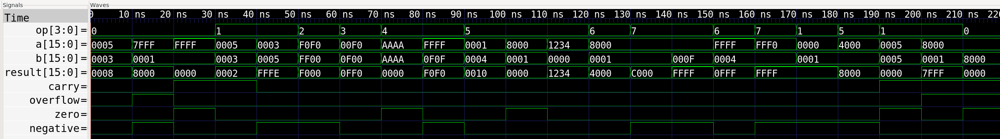

# 16-Bit ALU in Verilog

A 16-bit arithmetic logic unit with a self-checking testbench, simulated with Icarus Verilog and GTKWave.

## Operations

| op   | Operation | Result |
|------|-----------|--------|
| 0000 | ADD | a + b |
| 0001 | SUB | a - b |
| 0010 | AND | a & b |
| 0011 | OR  | a \| b |
| 0100 | XOR | a ^ b |
| 0101 | SLL | a << b[3:0] (logical left) |
| 0110 | SRL | a >> b[3:0] (logical right) |
| 0111 | SRA | a >>> b[3:0] (arithmetic right) |

## Flags

- **Zero**: result is all zeros
- **Negative**: top bit of the result is 1
- **Carry**: carry-out of ADD/SUB. For SUB, 1 means no borrow (ARM convention)
- **Overflow**: signed overflow, defined for ADD and SUB only

## Verification

`tb_alu16.v` is a self-checking testbench with 22 directed tests covering all
operations plus edge cases: signed overflow, carry, zero results, shift by 0,
and arithmetic shifts of negative values. 

Result: **22 passed, 0 failed**.

## Run it

    iverilog -Wall -o tb tb_alu16.v alu16.v
    vvp tb
    gtkwave alu16.vcd

## Planned

Block diagram and a clocked (registered) version of the ALU.